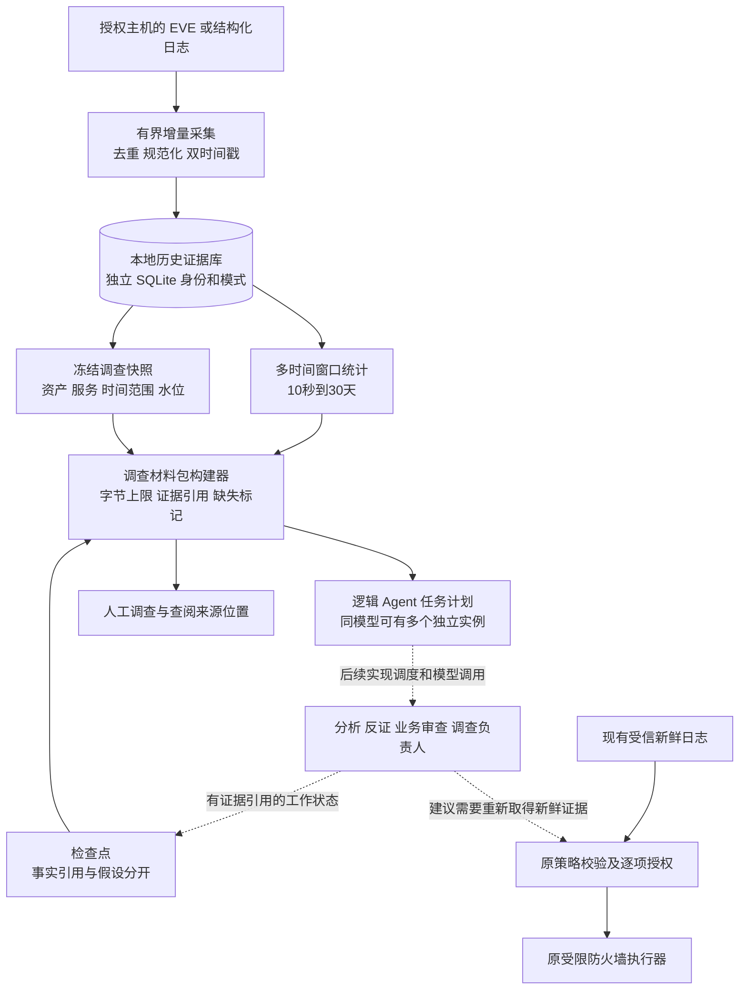
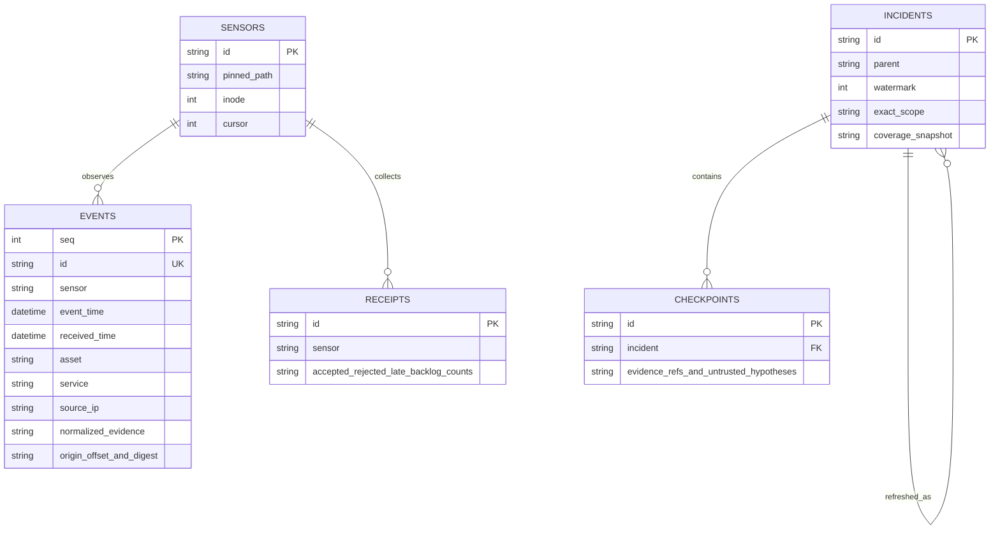

# 长期证据与多时间窗口调查架构

架构预览日期：2026-10-15。此版先建设本地证据与调查接口，解决上下文有限、历史线索散落和多实例共用证据的问题。高能力模型的岗位是调查负责人：规划补证、综合冲突、形成建议；长期记忆由本地证据系统保存。

本次已实现本地采集、时间窗口查询、调查快照、受限材料包、工作检查点和逻辑 Agent 任务规划。任务规划不启动模型。现有封禁执行器继续只接受自己的新鲜证据与明确授权；历史调查数据没有封禁权限。本次依照用户要求没有运行或新增测试，也没有调用模型、修改主机防火墙或自动发布到 GitHub。

## 数据路径和权限边界



实线是此版已实现的数据接口；虚线的模型派发和分析结果自动闭环是后续工作。历史库与原观察库、root 状态/审计库分开，不能互相当作可信输入。

## 模块及职责

| 模块 | 已实现职责 | 不能做什么 |
|---|---|---|
| `evidence.py` | 独立数据库、采集游标、来源位置、事件索引、调查范围与快照、多时间窗口、序列统计、本地日志链 | 不连接模型，不改防火墙，不接受模型提供的 SQL |
| `investigation.py` | 组装有界材料包、校验引用、追加工作检查点、生成多实例岗位计划 | 不把文本假设提升为事实，不运行 Agent，不授权动作 |
| `evidence_cli.py` | 暴露固定参数命令、独占创建导出文件、输出覆盖缺口 | 不接受任意查询语句、Shell、网络抓取目标 |
| 原 `core.py` / `broker.py` | 保留封禁证据时效、保护名单、明确授权与 TTL | 不因为历史关联或模型投票而放宽权限 |

全部使用 Python 标准库。新模块运行于普通用户；root 运行历史库命令会被拒绝。离线安装器复制新模块并提供 `/etc/aegis-fw/evidence.json` 配置示例，数据库仍由普通用户在自己的私有目录中创建。

## 存储契约



- `event_time` 表示日志声明的发生时间；`received_time` 是采集程序入库时间。统一输出 UTC ISO 格式，迟到事件保留并标记。发生时间来自传感器，并不因此获得真实性证明。
- `id` 绑定传感器标签和规范化事件；重读同一记录不重复保存。来源标签不是认证身份，不能替代日志源鉴权。
- 保存规范化数字/枚举字段、原文件路径、字节偏移、长度及原始行 SHA-256。payload、URL、请求正文、告警自由文本不会进入历史材料包。原始日志仍由管理员的日志系统保管；本模块不复制完整原文。
- 采集游标、事件、采集收据和日志链在同一事务内提交。批次失败则回滚，避免游标先走而证据未保存。
- 同一 sensor 固定绑定输入路径。检测到 inode 改变或截断时从新文件开头采集，并明确标记连续性未知。未完成的末行暂不消费；超长行使本批次失败。
- 数据库有独立 application ID/schema，拒绝接管原观察库、root 审计库、任意旧 SQLite 文件或符号链接。文件要求当前用户所有、0600，父目录不能被其他用户写入。
- 每批默认最多2万行、4 MiB，单行64 KiB；默认事件数量20万、调查快照1万、采集收据5万、每份快照最多100个检查点、数据库软预算512 MiB。软预算在批次前检查，单批写入、索引/WAL可能超出阈值；它不是文件系统硬配额。

## 不同时间尺度的含义

默认查询窗口为10秒、1分钟、5分钟、1小时、1天、7天和30天。它们都相对于调查快照的结束时刻计算，并裁剪到本次调查的开始时刻。

| 参数 | 含义 |
|---|---|
| 采集周期 | 管理员何时执行 collect；此版没有常驻 collector 或定时器 |
| 窗口长度 | windows 查询覆盖的历史范围 |
| 分桶间隔 | series 每个 UTC 对齐时间桶的宽度 |
| 模型调用周期 | 后续调度器负责；此版不会自动调用模型 |
| 历史范围 | 默认允许入库最近30天、每次查询最多覆盖30天 |
| 数据保留 | 没有自动删除；入库范围不等于自动保留/清除策略 |

统计来自带索引的规范化事件，用固定 SQL 聚合，设置 SQLite 执行步数上限。此版没有预计算物化时序库；数据量大时查询可能因资源上限拒绝，应缩小范围。`series` 只返回有观察值的桶，缺桶不等于零流量。

迟到记录会落入它真实声明的时间桶。已冻结快照不会因新入库的迟到事件改变；使用 refresh 创建新的快照修订。每次修订有自己的 ID、水位和覆盖信息，旧快照保留。

## 受限证据查询与上下文

每份快照固定：数据库 ID、目标本机资产、TCP/UDP 服务、半开时间区间 `[since, until)`、可选源 IP、最大事件序号。查询范围必须属于现有主机策略的 `local_addresses`。

材料包包含：

1. 范围、证据水位及配置摘要；
2. 精确范围内的事件数量、来源数量、告警等级计数、迟到计数；
3. 多窗口统计，以及少量长期窗口锚点和近期记录；
4. 按实例分别保留的最近工作检查点，且标明其假设/问题为不可信文本；
5. 缺失的业务健康、变更历史、身份/进程遥测及外部网络视野；
6. 是否截断、是否省略检查点、已知采集缺口。

默认上下文硬限制为32 KiB UTF-8。先保留结构和长期锚点，再填入近期记录；不会假装返回完整历史。**字节上限不等于模型 token 上限**；选定模型后，还需在模型适配器中使用相应 tokenizer，并为提示词和输出预留空间。此版不自动把材料包发送到旧 Council，也不宣称已经解决所有模型的窗口适配。

原始文件路径/偏移只通过 `show` 显式输出，不进入模型材料包。若日志轮转或被删除，路径和摘要不能自动恢复原文，需客户的受控归档系统支持。

## 高能力模型和多实例

`plan` 输出的是任务清单，默认6个逻辑实例：两个流量分析、一个长期时间线分析、一个业务审查、一个独立反证、一个调查负责人。最多实例数默认为8。数量可配置，但此版只校验计划总量，不运行并发工作进程。

- 每个岗位基于同一证据快照和基础材料包；任务清单附带各实例专用材料及摘要，确保后续调用方能按 `context_id` 取到正确输入。
- 两个流量实例分别关注来源协调、目标集中及替代解释。
- 反证实例的专用材料会直接移除全部工作记忆；其他调查实例仅获得自己的检查点，负责人可以汇总各实例状态。独立性落实在导出的内容中，不只写在提示词里。
- 调查负责人等其余岗位完成后综合分歧、要求补证；依赖关系已写入计划，执行依赖的调度器待实现。
- 模型名称暂不绑定。多个逻辑实例可以将来共用一个本地模型服务，并保持上下文隔离。
- 实例数量不是投票席位数，也不是模型权重副本数，更不是增加执行权限。

检查点只允许 `agent_instance`、`observed_evidence_ids`、`hypotheses` 和 `questions`。事实只保存证据引用，假设/问题包含文本及引用。材料包只扫描最近64个检查点，并在实例上限和字节预算内选取各实例最新状态；省略或扫描截断会明确标记。所有引用必须存在于本次快照的范围与水位内，不能引用后来入库的数据。自由文本永远不作为系统指令或执行规则。

## CLI 使用路径

所有命令在项目目录、普通用户环境中运行。以下是供用户操作的示例，本次未执行。

```sh
# 新建独立目录，避免覆盖已有文件。
HISTORY_DIR=$(mktemp -d /tmp/aegis-history.XXXXXX)

# 生成过去一周到最近数秒的合成告警，不发网络包。
python3 -m aegis_fw evidence demo-events --asset 192.0.2.10 > "$HISTORY_DIR/events.jsonl"

# 可反复执行：每次从已提交游标继续，批次有资源上限。
python3 -m aegis_fw evidence --store "$HISTORY_DIR/history.sqlite" collect "$HISTORY_DIR/events.jsonl" --sensor demo

# 固定目标服务，冻结过去8天的观察数据。
python3 -m aegis_fw evidence --store "$HISTORY_DIR/history.sqlite" open --asset 192.0.2.10 --service tcp:443 --lookback-hours 192

# 将返回的调查 id 替换 INCIDENT_ID。
python3 -m aegis_fw evidence --store "$HISTORY_DIR/history.sqlite" windows INCIDENT_ID
python3 -m aegis_fw evidence --store "$HISTORY_DIR/history.sqlite" series INCIDENT_ID --bucket-seconds 3600
python3 -m aegis_fw evidence --store "$HISTORY_DIR/history.sqlite" timeline INCIDENT_ID --limit 100
python3 -m aegis_fw evidence --store "$HISTORY_DIR/history.sqlite" brief INCIDENT_ID --output "$HISTORY_DIR/context.json"
python3 -m aegis_fw evidence --store "$HISTORY_DIR/history.sqlite" plan INCIDENT_ID --output "$HISTORY_DIR/agent-plan.json"

# 追加工作状态；示例没有虚构已确认事实。
python3 -m aegis_fw evidence --store "$HISTORY_DIR/history.sqlite" checkpoint INCIDENT_ID examples/checkpoint.json

# 采集更多数据后创建新的快照，旧快照不变。
python3 -m aegis_fw evidence --store "$HISTORY_DIR/history.sqlite" refresh INCIDENT_ID
python3 -m aegis_fw evidence --store "$HISTORY_DIR/history.sqlite" status
```

使用 `--policy /etc/aegis-fw/policy.json` 时，将它放在 `evidence` 之前；`--store`、`--config` 放在 `evidence` 之后、子命令之前。示例的 `192.0.2.10` 来自演示策略，生产必须改成已授权本机地址。合成事件不得复制到执行器受信日志。

导出使用独占创建0600文件，已有目标文件时拒绝覆盖。证据数据库必须与旧 `--db`、root 状态/审计库分开；`--db` 不控制新历史库。

## 当前边界与后续接口

此版只有告警/log-rule 数据，不能据此观察正常流量全貌、确认多个来源受同一攻击者控制，或看到攻击者在外部的准备。没有传感器心跳、丢包证明或认证通道，所以“覆盖完整”始终标为未知。时间戳相近和相同 IP 都不是攻击归属证明。

业务健康/资产/身份/变更记录的连接器、定时采集服务、统计基线、跨资产关联图、模型派发、模型 tokenizer 预算和 A/B场景状态机仍待实现。不要把任务清单当成已运行的多 Agent 系统。

历史库为普通用户的分析材料：文件权限和本地哈希链不提供加密，也不能抵抗 owner/root 重写、截断或删除。真正保密部署还需网络出站控制、受控归档、磁盘加密及客户侧制度和权限。

下一阶段的调用接口应只开放固定的“指定资产/服务/时间范围查询”和“追加带引用的调查结论”。执行器继续从自己的受信日志重新验证新鲜证据；不得把历史摘要、向量检索命中或模型多数票直接转换成封禁凭证。

## 设计参考

- [OWASP 日志指南](https://cheatsheetseries.owasp.org/cheatsheets/Logging_Cheat_Sheet.html)：事件时间与日志时间、关联标识、日志完整性与敏感内容控制。
- [MITRE ATT&CK Stage Capabilities](https://attack.mitre.org/techniques/T1608/)：攻击可有前置准备阶段，且部分活动超出目标组织的可见范围；长期查询不能消除这个视野边界。
